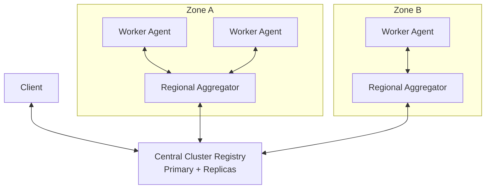
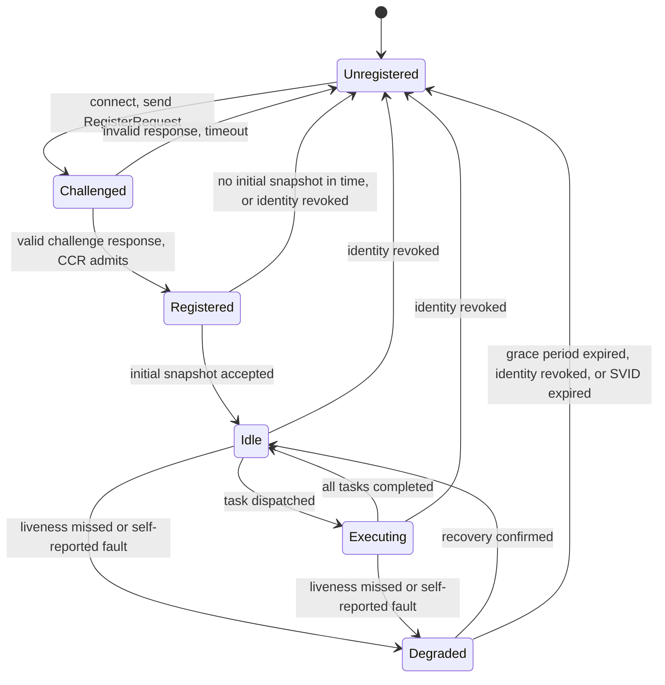

# a2a-control-plane Specification 02: Topology

**Status:** Draft v0.1.0  
**Scope:** Component boundaries, Worker Agent lifecycle, and message topic namespace.

## 1. Conventions

The key words "MUST", "MUST NOT", "REQUIRED", "SHALL", "SHALL NOT", "SHOULD", "SHOULD NOT", "RECOMMENDED", "NOT RECOMMENDED", "MAY", and "OPTIONAL" in this document are to be interpreted as described in BCP 14 ([RFC 2119], [RFC 8174]) when, and only when, they appear in all capitals.

## 2. Terminology

| Term | Definition |
|------|------------|
| **Central Cluster Registry** (CCR) | The single logical authority for agent identity, admission, and the record of zone membership. Replicated for availability (Primary/Replica). |
| **Regional Aggregator** (RA) | A per-zone component that terminates Worker connections, relays registration, routes tasks, and aggregates state deltas. A zone runs one or more **instances** that share one SPIFFE ID. |
| **Worker Agent** (WA) | An agent process that executes tasks. |
| **Client** | An authenticated, authorized party that submits tasks through the CCR or administers the cluster. |
| **Zone** | A failure and trust domain identified by `zone_id`. Each Worker belongs to exactly one zone. |
| **Session** | One admitted connection of a Worker to one Aggregator instance, identified by `session_id`. A new connection is a new session. |
| **Delta** | A message carrying only changed state, as defined in [03-protocols](03-protocols.md). |
| **Snapshot** | A message carrying complete state, used to start a session and to recover from loss ([05-operations](05-operations.md) Section 2). |

## 3. Topology Overview



The topology is a strict three-tier tree with clients attached to the root. Edges not shown above MUST NOT exist. In particular there is no Worker-to-Worker path and no Worker-to-Registry data path.

## 4. Interaction Boundaries

### 4.1 Central Cluster Registry

- The CCR MUST be the sole authority that admits Workers and Aggregators to the cluster ([04-control-api](04-control-api.md) Sections 2 and 3).
- The CCR MUST maintain the authoritative mapping of `agent_id` to `zone_id`, to capability set, and to owning Aggregator instance. Zone membership is established by the SPIFFE ID that SPIRE issues ([01-identity](01-identity.md) Section 2.1). The CCR's mapping records it. The CCR MUST NOT record a Worker in a zone different from the zone in its SPIFFE ID.
- The CCR MUST run as one Primary and one or more Replicas and MUST meet the guarantees of [05-operations](05-operations.md) Section 4.1. Only the Primary MAY accept writes. Replicas MUST serve reads and MUST be promotable without changing any identity.
- The CCR MUST NOT carry task traffic for Workers. It MAY relay a client's task submission and its outcome to an Aggregator ([04-control-api](04-control-api.md) Section 4). In that role it MUST NOT inspect payloads and MUST NOT retain them after the outcome is returned.
- The CCR MUST communicate only with Regional Aggregators, authorized clients and administrative clients. It MUST NOT accept connections from Worker Agents. A Worker's registration reaches it only as calls made by its Aggregator ([04-control-api](04-control-api.md) Section 2).

### 4.2 Regional Aggregator

- Each zone MUST have at least one Aggregator instance and SHOULD have at least two for availability. The instances of a zone satisfy [05-operations](05-operations.md) Section 4.2.
- An Aggregator MUST authenticate to the CCR with its own identity as defined in [01-identity](01-identity.md), and MUST attach as described in [04-control-api](04-control-api.md) Section 3.
- An Aggregator MUST be the only component through which a Worker sends or receives traffic.
- An Aggregator relays Worker registration to the CCR. It MUST NOT generate or judge a challenge.
- An Aggregator MUST dispatch tasks only to Workers in its own zone.
- An Aggregator MUST forward state to the CCR as batched, coalesced deltas. It MUST NOT forward every Worker heartbeat individually.
- An Aggregator MUST reject any Worker whose presented identity does not match the zone it serves.
- An Aggregator MUST NOT originate tasks. Tasks originate from authorized clients through the CCR or from other authorized control components.

### 4.3 Worker Agent

- A Worker MUST maintain exactly one authenticated, long-lived connection, to an Aggregator of its own zone.
- A Worker MUST NOT open connections to other Workers.
- A Worker MUST NOT open connections to the CCR.
- A Worker MUST publish only to its own `state` and `results` subjects and MUST subscribe only to its own `tasks` and `control` subjects (Section 6.3).
- A Worker MUST report state changes as deltas and SHOULD NOT report unchanged state.

### 4.4 Summary Matrix

"Y" means the interaction is permitted. Every other interaction MUST NOT occur. A response on a call that the caller opened is part of that call and is not a separate interaction.

| From \ To | CCR | RA (own zone) | RA (other zone) | WA | Client |
|-----------|-----|---------------|-----------------|----|--------|
| **CCR** | n/a | Y | Y | N | N |
| **RA** | Y | n/a | N | Y (own zone) | N |
| **WA** | N | Y | N | N | N |
| **Client** | Y | N | N | N | n/a |

## 5. Worker Agent State Machine

### 5.1 States

| State | Meaning |
|-------|---------|
| `Unregistered` | The Worker has no valid registration. |
| `Challenged` | The Aggregator has issued a registration challenge and awaits a valid response. |
| `Registered` | The CCR has admitted the Worker and recorded its zone and capabilities. |
| `Idle` | The Worker is registered, healthy, and has no active task. |
| `Executing` | The Worker is processing at least one task. |
| `Degraded` | The Worker is reachable but unhealthy, or has missed liveness deadlines. |

### 5.2 Transitions



| # | From | To | Trigger | Required behavior |
|---|------|----|---------|-------------------|
| T1 | `Unregistered` | `Challenged` | Worker connects over mTLS and sends a registration request. | The Aggregator MUST relay the request unchanged to the CCR. The CCR MUST generate the single-use nonce (at least 128 bits) and issue the challenge ([04-control-api](04-control-api.md) Section 2). The Aggregator MUST NOT generate or judge a challenge. |
| T2 | `Challenged` | `Registered` | Worker returns a valid response to the challenge within the challenge timeout. | The CCR MUST verify the response against the Worker's identity, MUST record `agent_id`, `zone_id`, the admitted capabilities and the owning instance, and MUST then confirm admission. |
| T3 | `Challenged` | `Unregistered` | Invalid response or timeout. | The Aggregator MUST close the connection. The nonce MUST be invalidated. |
| T4 | `Registered` | `Idle` | The Aggregator accepts the Worker's initial snapshot, which MUST equal the admitted capability set. | The Aggregator MUST begin dispatching to the Worker on its `tasks` subject and MUST report the change to the CCR. |
| T5 | `Idle` | `Executing` | The Aggregator dispatches a task to the Worker. | The Aggregator MUST report the change to the CCR. |
| T6 | `Executing` | `Idle` | The last in-flight task completes or is cancelled. | The Aggregator MUST report the change to the CCR. |
| T7 | `Idle` or `Executing` | `Degraded` | The Aggregator misses the Worker's liveness deadline (see [03-protocols](03-protocols.md) Section 6), or the Worker reports a fault by advertising `cp.health` with value `fault` ([03-protocols](03-protocols.md) Section 5.2). | The Aggregator MUST stop dispatching new tasks to the Worker and MUST report the change to the CCR. |
| T8 | `Degraded` | `Idle` | Liveness is restored and the Worker is not reporting a fault. | The Aggregator MUST resume dispatch only after it has reported the change to the CCR. |
| T9 | `Degraded` | `Unregistered` | The recovery grace period expires. | The Aggregator MUST close the connection and the CCR MUST mark the Worker unregistered. Tasks assigned to the Worker MUST be reassigned or failed. |
| T10 | Any registered state | `Unregistered` | Identity revoked or SVID expired without renewal, or the session replaced by a new one. | The Aggregator MUST close the connection immediately. Tasks assigned to the Worker MUST be reassigned or failed. |
| T11 | `Registered` | `Unregistered` | The registration timeout expires before the initial snapshot is accepted. | The Aggregator MUST close the connection and MUST report the change to the CCR. |

A Worker does not report `Idle` or `Executing` itself. The Aggregator derives them from the tasks it dispatches and the results it receives, and reports them to the CCR ([03-protocols](03-protocols.md) Section 9).

Any transition not listed in the table MUST NOT occur. An implementation receiving an event that would cause an unlisted transition MUST ignore the event and SHOULD log it.

### 5.3 State Invariants

- A Worker MUST NOT receive tasks in any state other than `Idle` or `Executing`.
- The CCR MUST treat the Aggregator's view as authoritative for `Idle`, `Executing`, and `Degraded`, and MUST treat its own record as authoritative for `Unregistered`, `Challenged`, and `Registered`.
- The defaults are listed in [05-operations](05-operations.md) Section 1.1: challenge timeout 10 seconds, registration timeout 30 seconds, recovery grace period 120 seconds. Each MUST be configurable.

### 5.4 Sessions

- Each admission creates a session. A Worker has at most one session at a time. A new admission for the same Worker replaces the existing session, which ends as in T10 ([04-control-api](04-control-api.md) Section 2.6).
- State, sequence numbers and in-flight task assignments belong to a session. They do not carry over to the next one.
- Establishing a replacement connection, for example because the SVID was renewed, creates a new session ([05-operations](05-operations.md) Section 6).

## 6. Message Topic Namespace

Asynchronous messages use a hierarchical, dot-delimited subject namespace, compatible with NATS subject syntax.

### 6.1 Subject Grammar

```
subject    = "a2a" "." scope
scope      = "zone" "." zone-id "." target
target     = "agent" "." agent-id "." channel / "aggregator" "." channel
channel    = "tasks" / "state" / "results" / "control"
zone-id    = token
agent-id   = token
token      = 1*( ALPHA / DIGIT / "-" / "_" )
```

- A token MUST NOT contain `.`, `*`, `>`, or whitespace.
- A token MUST be 1 to 64 characters.
- Subject names are case sensitive. Implementations SHOULD use lowercase.

### 6.2 Defined Subjects

| Subject | Direction | Purpose |
|---------|-----------|---------|
| `a2a.zone.<zone_id>.agent.<agent_id>.tasks` | Aggregator to Worker | Task dispatch to one Worker. |
| `a2a.zone.<zone_id>.agent.<agent_id>.state` | Worker to Aggregator | State deltas, snapshots and heartbeats. |
| `a2a.zone.<zone_id>.agent.<agent_id>.results` | Worker to Aggregator | Task results. |
| `a2a.zone.<zone_id>.agent.<agent_id>.control` | Aggregator to Worker | `ControlMessage`: task cancellation, heartbeat configuration and resync requests ([03-protocols](03-protocols.md) Section 8). |
| `a2a.zone.<zone_id>.aggregator.state` | Aggregator to CCR | `ZoneStateReport`: coalesced deltas and lifecycle changes ([03-protocols](03-protocols.md) Section 9). |

### 6.3 Subject Permissions

The subject namespace has two jobs. It is the logical address of every message and the unit on which authorization is expressed, whatever the transport. It is also the physical addressing of the regional bus, which carries the zone reports to the CCR and MAY carry Worker traffic between the instances of a zone.

A Worker's connection is a gRPC stream to an Aggregator ([03-protocols](03-protocols.md) Section 2), and the Aggregator maps that stream to the Worker's subjects. Whether those messages are also published on the regional bus is an implementation choice within the zone. Where they are, the bus MUST enforce the permissions below for the Worker's identity, as if the Worker had published them itself.

Wildcards follow NATS semantics: `*` matches exactly one token and `>` matches one or more trailing tokens.

| Role | May publish | May subscribe |
|------|-------------|---------------|
| Worker | `a2a.zone.<own_zone_id>.agent.<own_agent_id>.state` and `.results` | `a2a.zone.<own_zone_id>.agent.<own_agent_id>.tasks` and `.control`. A Worker MUST NOT use wildcards. |
| Aggregator | `a2a.zone.<own_zone_id>.agent.<agent_id>.tasks` and `.control`, and `a2a.zone.<own_zone_id>.aggregator.state` | `a2a.zone.<own_zone_id>.agent.*.state` and `a2a.zone.<own_zone_id>.agent.*.results`. An Aggregator MUST NOT subscribe outside its own zone. |
| CCR | Nothing. | `a2a.zone.*.aggregator.state` and, for diagnostics only, `a2a.zone.>`. |

Every other publish or subscription MUST be rejected.

Examples:

- `a2a.zone.eu-west-1.agent.*.state` is permitted to an Aggregator of zone `eu-west-1`, and matches the state subject of every Worker in that zone. It is not permitted to the Aggregator of any other zone.
- `a2a.zone.*.agent.worker-7.tasks` is not permitted to any Worker or Aggregator, because the zone token is a wildcard.
- `a2a.zone.eu-west-1.agent.worker-7.tasks` is permitted to the Worker `worker-7` of that zone as a subscription, and to an Aggregator of that zone as a publish. A Worker MUST NOT publish to it.

The CCR MUST NOT publish to the regional bus; it communicates with Aggregators over gRPC ([03-protocols](03-protocols.md) Section 2). The CCR reaches each regional bus as a subscriber ([05-operations](05-operations.md) Section 4.1). Only the Primary applies the reports it receives.

### 6.4 Authorization Binding

- Subject permissions MUST be derived from the authenticated SPIFFE identity (see [01-identity](01-identity.md)), not from client-supplied claims.
- A publish or subscribe outside the permissions in Section 6.3 MUST be rejected, and the rejection SHOULD be logged and counted ([05-operations](05-operations.md) Section 7).
- The `zone_id` and `agent_id` tokens in a Worker's subjects MUST match the zone and agent components of its SPIFFE ID.

## 7. Conformance

An implementation conforms to this document if it satisfies every MUST and MUST NOT statement for each role it implements. Implementations SHOULD publish a conformance statement listing roles and optional features supported ([05-operations](05-operations.md) Section 8).

## 8. Security Considerations

- Removing Worker-to-Worker paths eliminates lateral movement between compromised Workers. Network enforcement is demonstrated in [`reference/k8s-network-isolation.yaml`](../reference/k8s-network-isolation.yaml).
- Subject-level authorization is REQUIRED because a flat subject space would otherwise allow impersonation.
- Replay of registration responses is prevented by single-use nonces and short challenge timeouts.
- The threat model, with the effect of a compromised Worker, Aggregator or CCR, is in [06-threat-model](06-threat-model.md).

[RFC 2119]: https://www.rfc-editor.org/rfc/rfc2119
[RFC 8174]: https://www.rfc-editor.org/rfc/rfc8174
