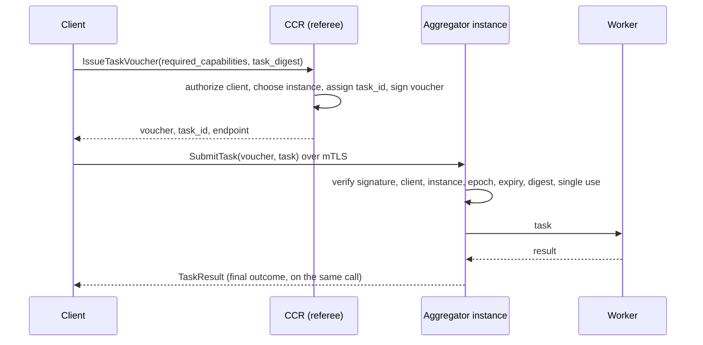

# a2a-control-plane Specification 04: Control API

**Status:** Draft v0.1.0  
**Scope:** Worker admission, Aggregator attachment, task origination by voucher, administration, version and feature negotiation, and the error model.

## 1. Conventions

The key words "MUST", "MUST NOT", "REQUIRED", "SHOULD", "SHOULD NOT", "RECOMMENDED", and "MAY" in this document are to be interpreted as described in BCP 14 ([RFC 2119], [RFC 8174]) when, and only when, they appear in all capitals.

The messages are defined in [`schemas/v1/registration.proto`](../schemas/v1/registration.proto), [`submission.proto`](../schemas/v1/submission.proto) and [`admin.proto`](../schemas/v1/admin.proto). The services are defined in [`services.proto`](../schemas/v1/services.proto) and are served over gRPC on port 50051 with the mTLS requirements of [01-identity](01-identity.md).

| Service | Served by | Called by | Purpose |
|---------|-----------|-----------|---------|
| `Registration` | CCR | Aggregator | Attach an Aggregator instance; relay a Worker's admission. |
| `Admin` | CCR | Administrative client | Revoke an identity; list Workers. |
| `TaskSubmission` | CCR | Authorized client | Obtain a task voucher. No payload. |
| `TaskIntake` | Aggregator instance | Client holding a voucher | Submit a task; cancel it; ask what became of it. |
| `ZoneControl` | Aggregator instance | CCR | Snapshot, revoke a Worker. |

## 2. Worker Admission

### 2.1 Roles

Admission follows the shape of a certificate authority with a registration authority in front of it:

- The **CCR is the root.** It alone decides whether a Worker is admitted. It generates and validates the challenge.
- The **Aggregator is an intermediary.** It terminates the Worker's mTLS connection, vouches for what it observed on that connection (the Worker's SPIFFE ID and the TLS channel binding), and relays messages. It MUST NOT generate a nonce, MUST NOT evaluate a signature, and MUST NOT admit a Worker on its own authority.

The analogy has one limit: the CCR does not issue the Worker's credential. The X.509-SVID comes from SPIRE ([01-identity](01-identity.md) Section 3). The CCR is the root of trust for admission, not for certificate issuance.

### 2.2 Exchange

```mermaid
sequenceDiagram
    participant W as Worker
    participant A as Aggregator (relay)
    participant C as CCR (root)
    W->>A: mTLS handshake (SVID)
    W->>A: RegisterRequest
    A->>C: BeginRegistration(spiffe_id, request bytes, svid_chain, channel_binding)
    C->>C: validate chain, zone, request, policy; negotiate
    C-->>A: RegistrationChallenge(nonce, timeout, version, features)
    A-->>W: RegistrationChallenge
    W->>W: sign payload (Section 2.3) with SVID key
    W->>A: signature
    A->>C: CompleteRegistration(spiffe_id, signature)
    C->>C: verify signature, consume nonce
    C-->>A: RegistrationAdmission(session_id, selected, admitted caps)
    A-->>W: RegistrationAdmission
    W->>A: first state message: snapshot of the admitted set
```

### 2.3 Challenge Payload

The Worker signs the following byte string with the private key of its current X.509-SVID. Each field is encoded as a 4-byte big-endian length followed by the field bytes, and the encoded fields are concatenated in this order:

| # | Field | Content |
|---|-------|---------|
| 1 | label | The ASCII bytes `a2a-cp/v1/register`. |
| 2 | nonce | `RegistrationChallenge.nonce`. |
| 3 | identity | The Worker's SPIFFE ID, as UTF-8. |
| 4 | request digest | SHA-256 of the exact serialized `RegisterRequest` the Worker sent. |
| 5 | channel binding | The TLS exporter value for the Worker's connection (RFC 9266, label `EXPORTER-a2a-cp-register`, empty context, 32 bytes). Empty only on a transport that has no TLS. |

- The signature algorithm is the one of the SVID's key. Implementations MUST support ECDSA P-256 and Ed25519.
- Length prefixes prevent one field from being confused with its neighbour.
- Binding the request digest means an intermediary cannot change the requested capabilities, versions or features without invalidating the signature.
- Binding the channel prevents a signature produced for one connection from being used on another.
- An Aggregator MUST forward `RegisterRequest` to the CCR byte for byte, as `BeginRegistrationRequest.register_request`.

### 2.4 CCR Requirements

On `BeginRegistration` the CCR:

1. MUST verify that the calling Aggregator instance is attached (Section 3) and that its zone equals the zone of `worker_spiffe_id`.
2. MUST validate `svid_chain` against the trust bundle and MUST verify that its URI SAN equals `worker_spiffe_id` and that the identity's trust domain is the CCR's own.
3. MUST reject a request that exceeds the message size limit, checking the size before it parses the bytes, and MUST reject a request that does not parse or contains an invalid capability map, including one with more capabilities than the limit ([03-protocols](03-protocols.md) Section 5.2).
4. MUST evaluate the requested capabilities against its capability policy and reject the request if the policy denies them. The policy itself is deployment defined.
5. MUST negotiate the version and features (Section 5).
6. MUST generate a nonce of at least 128 bits from a cryptographically secure source, bind it to the Worker's SPIFFE ID, the relaying instance and the request, and keep at most one outstanding nonce per Worker. A new `BeginRegistration` for the same Worker replaces the earlier nonce.

On `CompleteRegistration` the CCR:

1. MUST consume the nonce whether or not verification succeeds. A nonce MUST NOT be used twice.
2. MUST reject the call if the relaying instance differs from the instance that began the registration, if the nonce has expired (default 10 seconds, [05-operations](05-operations.md) Section 1), or if the signature does not verify against the SVID public key over the payload of Section 2.3.
3. On success MUST record `agent_id`, `zone_id`, the admitted capabilities, the `session_id` and the owning instance, MUST durably record the admission before acknowledging it ([05-operations](05-operations.md) Section 4.1), and MUST return `RegistrationAdmission`.

The admitted capabilities are the requested capabilities that passed policy. The CCR MUST NOT admit a capability set different from the one requested; it either admits the request or rejects it.

Every failure caused by identity, signature, nonce or policy MUST be reported to the caller as `PERMISSION_DENIED` with no detail that distinguishes the cause, so that the exchange does not reveal whether an identity or capability is known.

### 2.5 Worker and Aggregator Requirements

- The Worker MUST verify that `selected_version` is one it offered and that every selected feature is one it offered, and MUST abort the registration otherwise.
- After admission the Worker's first state message MUST be a snapshot ([03-protocols](03-protocols.md) Section 5) whose capability map equals `admitted_capabilities` exactly.
- The Aggregator MUST discard any other first message from a Worker in state `Registered`, and MUST count the discard.
- If the snapshot does not arrive within the registration timeout (default 30 seconds), the Aggregator MUST apply T11 ([02-topology](02-topology.md) Section 5.2).
- After a failure the Aggregator MUST close the Worker's connection.

### 2.6 Replacement Sessions

- A Worker with an established session MAY register again. The new registration creates a new session and replaces the old one.
- If the old session is held by the same instance, the instance MUST end the old session (T10) before the new registration can be admitted.
- If the old session is held by another instance, the CCR MUST call `ZoneControl.RevokeWorker` on that instance as part of admitting the new session, and MUST ignore any report from the old instance about that Worker afterwards ([05-operations](05-operations.md) Section 2.3).
- Tasks in flight on the old session are reassigned or failed as in T10. Session resumption is not defined in this version ([05-operations](05-operations.md) Section 6).

## 3. Aggregator Attachment

An Aggregator instance joins the cluster by calling `Registration.Attach`.

- Every instance of a zone shares one SPIFFE ID ([01-identity](01-identity.md) Section 2.1), so each instance MUST choose an `instance_id` that is unique among the instances of its zone and MUST present the same value for its lifetime.
- The CCR MUST accept `Attach` only from a peer whose SPIFFE ID has the Aggregator form and belongs to the CCR's trust domain, and only for a zone the operator has provisioned. It MUST reject any other call with `PERMISSION_DENIED`.
- The CCR MUST grant an `epoch` that is greater than any epoch it granted before for that zone, and MUST negotiate the version and features (Section 5).
- After a successful `Attach` the instance MUST send a snapshot report ([05-operations](05-operations.md) Section 2.3) as its first report, and MUST stamp `instance_id` and `epoch` on every report.
- An attach by an `instance_id` that is already attached replaces the earlier attachment. Before granting the new epoch the CCR MUST end the earlier attachment as described below, and MUST instruct the superseded instance, if it is still reachable, to end every Worker session it holds (`ZoneControl.RevokeWorker`). The superseded epoch is stale ([05-operations](05-operations.md) Section 4.2).
- An attachment ends when the instance calls `Detach`, when its identity is revoked, when it is replaced, or when the CCR cannot reach the instance's `ZoneControl` service for the attachment timeout (default 30 seconds). The CCR SHOULD use the gRPC health checking protocol for the last case.
- When an attachment ends, the CCR MUST remove the Worker records the instance owned. Tasks in flight on the instance end with a transport error on the clients' calls to it (Section 4.5).
- An instance MUST advertise, in `AttachRequest.endpoint`, the address at which clients reach its `TaskIntake` service. The CCR hands it to clients with a voucher, and MUST NOT choose an instance that advertised none.

## 4. Task Origination

The CCR is an authorization and routing referee. It never receives a task payload. A client asks the CCR for a signed **task voucher**; the voucher names one Aggregator instance and is bound to one client and one task. The client then delivers the task, with the voucher, directly to that instance.



### 4.1 Voucher Issuance

A client requests a voucher with `TaskSubmission.IssueTaskVoucher`. The request carries routing metadata (`required_capabilities`, optionally `zone_id`) and `task_digest` (Section 4.2). It MUST NOT carry the payload.

- The client MUST authenticate over mTLS with an identity of the form `spiffe://<trust-domain>/client/<client_id>` ([01-identity](01-identity.md) Section 2.1). The CCR MUST authorize the client against a policy that is deployment defined and MUST deny the request when no policy is configured. The policy MAY consider the client's identity and `required_capabilities`. It MUST NOT depend on anything the client asserts about itself.
- `task_digest` MUST be a SHA-256 digest (32 bytes). `required_capabilities` MUST satisfy [03-protocols](03-protocols.md) Section 5.2. The CCR MUST reject anything else with `INVALID_ARGUMENT`.
- The CCR MUST choose an attached Aggregator instance that, according to its records, serves at least one Worker that is `Idle` or `Executing` and advertises every entry of `required_capabilities`. If `zone_id` is set it MUST consider only that zone. Among suitable instances the choice is implementation defined; the CCR SHOULD prefer the instance that serves the most matching Workers.
- If there is no suitable instance, the CCR MUST fail the request with `UNAVAILABLE` and the reason `no_eligible_worker`. The CCR's records are eventually consistent ([05-operations](05-operations.md) Section 2), so a voucher does not guarantee that a Worker is free: the Aggregator decides (Section 4.4).
- The CCR MUST assign `task_id`, MUST generate it from a cryptographically secure source with at least 128 bits of randomness, and MUST encode it in the token grammar of [02-topology](02-topology.md) Section 6.1. Clients do not choose task ids, so ids are unique by construction and the CCR needs no record of tasks in flight.
- The CCR MUST set `voucher_id` to 128 random bits, MUST set the voucher's lifetime (`expires_at_ns` minus `issued_at_ns`) to the voucher lifetime of [05-operations](05-operations.md) Section 1.1 (default 30 seconds), and MUST record the instance's `instance_id` and the epoch it granted.
- Only the Primary MAY issue vouchers.

The response contains the signed voucher, the `task_id` and the instance's `endpoint`. The CCR sees routing metadata and a digest. It does not see the payload, `kind` or `content_type`.

### 4.2 Task Digest

The client computes `task_digest` before it has a `task_id`. It is the SHA-256 of the length-prefixed concatenation ([2.3](#23-challenge-payload) describes the encoding) of these fields in this order:

| # | Field | Encoding |
|---|-------|----------|
| 1 | label | The ASCII bytes `a2a-cp/v1/task`. |
| 2 | `kind` | UTF-8. |
| 3 | `content_type` | UTF-8. |
| 4 | `payload` | The bytes. |
| 5 | `deadline_ns` | 8 bytes, big-endian. |
| 6 | capability count | 4 bytes, big-endian: the number of entries in `required_capabilities`. |
| 7 | capabilities | For each entry in ascending order of key (bytewise), the key then the value, each as UTF-8 and each as its own length-prefixed field. |

The digest covers everything the client controls. It excludes `task_id` and `attempt`, which the control plane assigns, and `trace_context`, which does not change what the task means. Because it binds the voucher to one task, a voucher cannot be reused for a different task.

### 4.3 Voucher and Signature

`SignedTaskVoucher.voucher` is the serialized `TaskVoucher`. The CCR signs the following byte string with the private key of its X.509-SVID, using the encoding of [Section 2.3](#23-challenge-payload): the label `a2a-cp/v1/voucher` and the exact bytes of `voucher`, each length-prefixed. The signature covers the bytes that were serialized, so no canonical form of the message is needed.

- `SignedTaskVoucher.signer_chain` MUST carry the CCR's X.509-SVID chain (DER, leaf first). A verifier MUST validate it against its trust bundle, MUST check that the leaf's URI SAN is `spiffe://<trust-domain>/registry`, and only then MUST verify the signature with the leaf's public key. A trust bundle holds the roots of trust, not the CCR's own key, so the chain is how a verifier obtains it.
- The signature algorithm is the one of the SVID's key. Implementations MUST support ECDSA P-256 and Ed25519.
- Because SVIDs are short lived ([01-identity](01-identity.md) Section 5), the voucher lifetime MUST NOT exceed the remaining lifetime of the SVID that signed it.

### 4.4 Aggregator Intake

The client calls `TaskIntake.SubmitTask` on the instance named in the voucher, over mTLS. The call carries the voucher and the `Task`; its `task_id` MUST equal the voucher's. The client MUST check that the Aggregator's SPIFFE ID is the Aggregator form of the voucher's zone.

The Aggregator MUST accept a submission only if every check passes, and MUST reject it otherwise without dispatching anything:

1. The caller's authenticated identity is a client of the Aggregator's trust domain.
2. The voucher's signature verifies against a chain that satisfies Section 4.3.
3. `client_spiffe_id` equals the caller's authenticated identity. A voucher is not a bearer token: it is of no use to anyone but the client it was issued to.
4. `zone_id`, `instance_id` and `epoch` equal this instance's own. A voucher is void at any other instance and at any other epoch of the same instance, so a restart invalidates the vouchers it had outstanding.
5. The current time is not before `issued_at_ns` and not after `expires_at_ns`, allowing the clock skew tolerance of [05-operations](05-operations.md) Section 1.1 (default 5 seconds) on each side.
6. The task's `task_id` equals the voucher's, its `attempt` is 1 or unset, and the digest of the task, computed as in Section 4.2, equals `task_digest`.
7. The `task_id` is not already in flight, and `voucher_id` has not been accepted before. The Aggregator MUST remember each accepted `voucher_id` until the voucher can no longer be presented, that is until its expiry plus the skew tolerance, and not for a shorter time. The memory MUST be bounded. When it is full of vouchers that can still be presented, the Aggregator MUST refuse new submissions with `RESOURCE_EXHAUSTED`, and MUST NOT evict an entry that has not expired. It MUST NOT use a least-recently-used or any other policy that drops live entries, because a voucher whose entry was dropped can be replayed. A refusal costs availability; an eviction costs the single-use guarantee. The Aggregator SHOULD cap the share of the memory that one client can hold.
8. The whole message, including the voucher and its signer chain, is within the size limit ([05-operations](05-operations.md) Section 5), checked before the content is parsed.

A rejection caused by checks 1 to 5, 7 or the replay of a voucher is `PERMISSION_DENIED` ([Section 7](#7-error-model)); a task already in flight is `ALREADY_EXISTS`; a malformed task is `INVALID_ARGUMENT`; a full voucher memory is `RESOURCE_EXHAUSTED`. A rejected submission does not consume the voucher, unless the voucher itself was already used.

After the checks the Aggregator selects a Worker as in [03-protocols](03-protocols.md) Section 7.1. If `deadline_ns` has passed, the outcome is `TASK_STATUS_REJECTED` with error code `deadline_exceeded` and `retryable` unset. If no Worker is eligible, which can happen because the CCR's records lag, the outcome is `TASK_STATUS_REJECTED` with error code `no_eligible_worker` and `retryable` set. The client then MAY request a new voucher.

The Aggregator MUST NOT dispatch a task for any other reason, and MUST NOT dispatch a task it received without a voucher, except from a control component inside its own trust boundary ([03-protocols](03-protocols.md) Section 7.1).

### 4.5 Outcome and Cancellation

- `SubmitTask` completes with exactly one `TaskResult`, the task's final outcome: the result that completed the task, or a failure produced under Section 4.6. Results that led to a reassignment are not returned ([03-protocols](03-protocols.md) Section 7.3).
- The Aggregator keeps running a task whose client has disconnected. A client that stops waiting does not cancel the task; it MUST call `TaskIntake.CancelTask`.
- `CancelTask` asks the instance to cancel a task in flight. Only the client that submitted the task MAY cancel it. For any other caller, and for an unknown or finished task, the response MUST be `accepted` false, so that an unauthorized caller cannot learn whether a task exists. The outcome still arrives on the original `SubmitTask` call, normally as `TASK_STATUS_CANCELLED` ([03-protocols](03-protocols.md) Section 7.4).
- If the instance fails or the connection breaks, the client sees a transport error (`UNAVAILABLE`) on its call. The task keeps running, and the client MUST NOT assume it did not. It asks the Aggregator's task ledger (Section 4.7) what became of the task. The CCR does not track tasks and does not report on them. A client that resubmits MUST request a new voucher, and a task whose effects must not repeat MUST be idempotent ([05-operations](05-operations.md) Section 3).

### 4.6 Errors Produced by the Control Plane

When the control plane, rather than a Worker, ends a task, it MUST use these codes:

| `TaskError.code` | Status | `retryable` | Produced when |
|------------------|--------|-------------|---------------|
| `deadline_exceeded` | `REJECTED` | false | The deadline had passed before dispatch or on receipt. |
| `no_eligible_worker` | `REJECTED` | true | No Worker was eligible when the Aggregator received the task. |
| `worker_lost` | `FAILED` | true | The Worker holding the task was lost and the task could not be reassigned. |
| `aggregator_lost` | `FAILED` | true | An Aggregator instance with a durable ledger started and found the task in flight from an earlier run of the same instance (Section 4.7). |
| `cancelled` | `CANCELLED` | false | The Worker stopped the task on request. |
| `result_too_large` | `FAILED` | false | The Worker's result exceeded the size limit. |

`retryable` is a hint to the originator. An originator that resubmits after `worker_lost` or `aggregator_lost`, or after a transport error, MUST accept that the earlier attempt may have run in part ([05-operations](05-operations.md) Section 3).

### 4.7 Task Ledger

The CCR keeps no record of tasks, so a client whose call to an Aggregator broke cannot ask the CCR what happened. The Aggregator keeps a ledger instead and answers from it.

- On accepting a task under Section 4.4, the Aggregator MUST write a ledger entry for it before it dispatches the task: the `task_id`, the submitting client's SPIFFE ID, its own `instance_id` and `epoch`, and the time of acceptance. When the task reaches its final outcome the Aggregator MUST record the `TaskResult` in the entry, including outcomes it produced itself (`deadline_exceeded`, `no_eligible_worker`, `worker_lost`). The first outcome recorded stands.
- `TaskIntake.GetTaskStatus` returns the phase of a task (`TASK_PHASE_IN_FLIGHT` or `TASK_PHASE_COMPLETED`) and, once completed, the final `TaskResult`. Only the client that submitted the task MAY ask. For any other caller, and for a task the ledger does not hold, the Aggregator MUST answer `NOT_FOUND`, so that an unauthorized caller cannot learn whether a task exists.
- Any instance of the zone that can read the ledger MAY answer `GetTaskStatus`, so a client can ask another instance when the one it used is unreachable. Only the instance that accepted a task writes its entry. The ledger is not an exception to the rule that instances share no state that would let two of them act on one session ([05-operations](05-operations.md) Section 4.2): it records outcomes and never drives dispatch.
- The Aggregator MUST keep a completed entry for at least the ledger retention ([05-operations](05-operations.md) Section 1.1, default 15 minutes) and MAY then discard it. It MUST NOT discard an entry for a task in flight. It MUST bound the number of completed entries it keeps and discard the oldest first when the bound is reached.
- A completed entry holds the task's result, which is application data. The ledger MUST be given the protection the Aggregator gives payloads, including access control that admits only the instances of the zone, and a durable backing SHOULD encrypt it at rest. The ledger MUST NOT hold the task's payload.
- **Durability.** An implementation MUST provide the ledger and `GetTaskStatus`. It MAY keep the ledger in memory, which survives a client's disconnect and not an Aggregator restart. A deployment that needs the answer to survive a restart SHOULD back the ledger with a durable store local to the region. [NATS JetStream](https://docs.nats.io/nats-concepts/jetstream) is the recommended store, because the regional bus is already NATS; one stream per zone, keyed by `task_id`, with the retention above as the stream's maximum age. The store is a deployment choice and is not negotiated.
- **Recovery.** An instance with a durable ledger MUST, when it starts and has attached, end every entry still in flight that an earlier run of the same `instance_id` wrote. It MUST record `TASK_STATUS_FAILED` with error code `aggregator_lost` and `retryable` set, because the Worker sessions of the earlier run ended with it ([05-operations](05-operations.md) Section 4.2). The client then learns a definite outcome.
- The ledger is local to a region. A client reaches it through the Aggregator's `TaskIntake` service, not through the CCR.

## 5. Version and Feature Negotiation

- A peer advertises the schema major versions it supports and the optional features it supports. A Worker does so in `RegisterRequest`, an Aggregator instance in `AttachRequest`.
- The CCR MUST select the highest major version supported by both sides. If there is none, it MUST reject the call: `FAILED_PRECONDITION` for an Aggregator, and `PERMISSION_DENIED` for a Worker ([Section 2.4](#24-ccr-requirements)).
- The CCR MUST select the features that both sides support, and MUST always include `recovery.snapshot`.
- An unknown feature MUST be ignored. A feature name is 1 to 64 characters from `a-z`, `0-9`, `.`, `_` and `-`. A peer MUST NOT advertise more than 32 features.
- Selection is made once, at admission or attachment, and does not change for the session or epoch.

Defined features:

| Feature | Status | Meaning |
|---------|--------|---------|
| `recovery.snapshot` | REQUIRED of every implementation | Recovery from lost state by full snapshot ([05-operations](05-operations.md) Section 2). |
| `recovery.replay` | OPTIONAL | Recovery of zone reports by replay from a durable bus ([05-operations](05-operations.md) Section 2.4). |

Features that change message semantics MUST be introduced as a new feature name; they MUST NOT be signalled by changing the meaning of existing fields.

## 6. Administration

`Admin.RevokeIdentity` revokes a Worker or Aggregator SPIFFE ID, and `Admin.ListWorkers` returns the Workers the CCR knows.

- The CCR MUST authenticate administrative clients over mTLS and MUST authorize them by policy. Only the Primary MAY execute `RevokeIdentity`. Replicas MAY serve `ListWorkers`, and MUST mark the response as potentially stale when their replication lag exceeds the configured bound ([05-operations](05-operations.md) Section 4.1).
- Revoking a Worker MUST remove its record, MUST discard any pending challenge, MUST call `ZoneControl.RevokeWorker` on the owning instance so that the Aggregator closes the connection immediately, and MUST cause the SPIRE registration entry to be removed ([01-identity](01-identity.md) Section 7).
- Revoking an Aggregator identity MUST detach every instance of that zone (Section 3).
- Revocation is idempotent. `RevokeResponse.found` is false when the identity was not known.
- `ZoneControl.RevokeWorker` MUST end the session as T10 and MUST be acted on immediately.
- Every revocation MUST be written to the audit log ([05-operations](05-operations.md) Section 7).

## 7. Error Model

Calls on the services return gRPC status codes with these meanings. An implementation MUST NOT use them for other conditions.

| Status | Used for |
|--------|----------|
| `INVALID_ARGUMENT` | A malformed message, an invalid `task_digest` or capability map, a `task_id` that does not match the voucher, an `attempt` greater than 1, a size or capability limit exceeded. |
| `ALREADY_EXISTS` | A `task_id` already in flight at the Aggregator. |
| `NOT_FOUND` | An administrative lookup for an unknown identity, where the response has no `found` field; `GetTaskStatus` for a task the ledger does not hold or that another client submitted (Section 4.7). |
| `PERMISSION_DENIED` | The caller is not authorized; a Worker registration failed (Section 2.4); a voucher failed a check of Section 4.4 or was already used. |
| `FAILED_PRECONDITION` | No common version; an instance that is not attached; a write sent to a CCR that is not the Primary. |
| `UNAVAILABLE` | No Primary is reachable; no Aggregator instance serves a matching Worker (reason `no_eligible_worker`, Section 4.1); an Aggregator instance is unreachable or failed during a call. The caller SHOULD retry with the backoff of [05-operations](05-operations.md) Section 6. |
| `RESOURCE_EXHAUSTED` | A rate or concurrency limit ([05-operations](05-operations.md) Section 5); an Aggregator's voucher memory is full (Section 4.4). |

Errors produced for a task are carried in `TaskResult`, not as a status (Section 4.6). A `SubmitTask` call that reaches a Worker's outcome returns status `OK` even when the task failed.

## 8. Security Considerations

- The registration exchange tolerates an untrusted relay: the Aggregator can drop or delay messages and can refuse to relay, but it cannot admit a Worker, cannot alter a request undetected, and cannot reuse a signature on another connection.
- A compromised Aggregator can still lie about what it observed on the Worker's connection. The CCR therefore validates the SVID chain itself and binds the admission to the Worker's SPIFFE ID, and does not rely on the Aggregator's assertion of identity alone. See [06-threat-model](06-threat-model.md).
- Uniform `PERMISSION_DENIED` responses prevent the exchange from being used to probe which identities or capabilities exist.
- A voucher is a capability, so it is constrained on every axis a thief or a replay could use: it is bound to one client identity, one Aggregator instance and epoch, one task digest and one lifetime, and it is accepted once. Stealing a voucher is of no use without the client's credential, and a leaked one cannot carry a different task.
- The CCR sees routing metadata and a digest, never a payload. It can still decide which tasks may be sent and where, so a compromised CCR can authorize work it should not; it cannot read or alter the tasks themselves. Payload confidentiality from the Aggregator needs end-to-end encryption at the application layer, since the control plane treats payloads as opaque.
- A voucher check depends on wall-clock time. The skew tolerance bounds the window in which a clock fault could let an expired voucher through or reject a valid one.
- The voucher memory fails closed. Filling it denies service to new submissions but never lets a voucher be accepted twice, which is why it caps one client's share and does not evict live entries.
- The task ledger keeps results at rest for the retention period. It widens the exposure of results beyond the call that carried them, so it has the same access control as payloads in flight and an encrypted durable backing.

## 9. Future Work: Overlapping SVID Validity (Informational)

**This section is a note, not a requirement. Nothing here is normative in this version, and no implementation is expected to follow it.**

Today a credential rotation ends a Worker's session: the replacement connection registers again, and the tasks on the old session are reassigned or failed ([01-identity](01-identity.md) Section 5, [05-operations](05-operations.md) Section 6). A long-running task can therefore be lost to a routine rotation. A later version should remove that with a grace period in which two credentials are valid at once. The notes below record what such a version would need, so that the design is not rediscovered.

TODO for a later version:

1. **Two SVIDs at once.** A component should be able to hold the expiring SVID and its renewal together for an overlap window, and peers should accept either of them for that component's SPIFFE ID during the window. The window should be bounded, for example by a fraction of the SVID lifetime, so that the one-hour ceiling on credential life still holds in effect.
2. **Make before break.** A Worker should open the replacement connection with the new SVID while the old one still carries traffic, hand the session over, and only then close the old connection. In-flight tasks should stay with the session. This needs a session-handover exchange that proves the two connections belong to one Worker, for example a handover token the old session issues and the new session presents, bound to the new SVID and used once.
3. **Drain on the expiring credential.** After the handover, results of tasks still running on the expiring credential should be accepted on the old connection until the tasks finish or the window ends, and new tasks should go only to the new connection. A Worker that cannot finish by the end of the window should fail the task visibly, not leave it to be reassigned silently.
4. **Revocation must still bite.** Revoking an identity should end both connections at once. An overlap window must not become a way to outlive a revocation, so the revocation path has to name the identity and not a single connection.
5. **Aggregators and the CCR.** The same overlap should apply to their credentials. A voucher signed by the CCR's expiring SVID should stay valid for its short lifetime, which the rule that a voucher lifetime does not exceed its signer's remaining life ([Section 4.3](#43-voucher-and-signature)) would need to be relaxed or re-expressed for.
6. **Negotiation.** The capability should be advertised as a feature ([Section 5](#5-version-and-feature-negotiation)), so that peers that do not support it keep the current behaviour.

Open questions: how a verifier learns that a second SVID is legitimate without a new round trip to the CCR; whether a handover token can be replayed across Aggregator instances of a zone; and how the overlap interacts with the single-session rule of [02-topology](02-topology.md) Section 5.4. See also the residual risk in [06-threat-model](06-threat-model.md).

[RFC 2119]: https://www.rfc-editor.org/rfc/rfc2119
[RFC 8174]: https://www.rfc-editor.org/rfc/rfc8174
