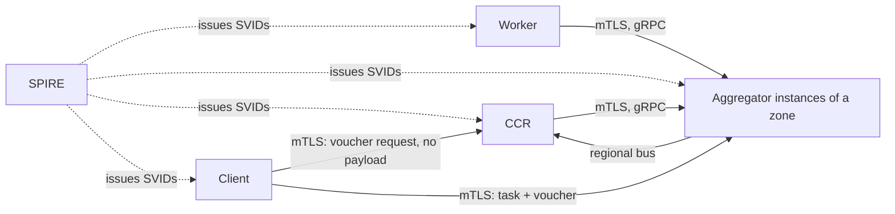

# a2a-control-plane Specification 06: Threat Model

**Status:** Draft v0.1.0  
**Scope:** Assets, trust boundaries, adversaries, what the specification prevents, and what it leaves open.

This document is informative. It explains why the normative rules in [01](01-identity.md) to [05](05-operations.md) are shaped as they are, and it records the risks that remain.

## 1. Assets

| Asset | Why it matters |
|-------|----------------|
| Worker identity (SVID private key) | Proves who a Worker is. Theft allows impersonation until the SVID expires or is revoked. |
| Admission decision | Decides which agents may take part in the cluster and with which capabilities. |
| Zone isolation | Keeps a compromise in one zone from reaching another. |
| Task payloads and results | Application data; opaque to the control plane. |
| Cluster state (Worker records, capabilities, lifecycle states) | Drives task placement. False state misdirects work. |
| Availability of the control plane | Agents cannot be admitted or given work without it. |

## 2. Trust Boundaries

- Every boundary is authenticated with mutual TLS using SPIFFE identities. No component accepts a claim about identity, zone or role from the payload of a message.
- SPIRE is the root of trust for identities. The CCR is the root of trust for admission, not for certificate issuance ([04-control-api](04-control-api.md) Section 2.1).
- Instances of one zone share a SPIFFE ID and therefore trust each other fully. There is no boundary between them.

## 3. Adversaries and Effects

| Adversary | Can do | Prevented or limited by | Residual risk |
|-----------|--------|-------------------------|---------------|
| **A1. Compromised Worker** | Run arbitrary code with a valid SVID for one `agent_id`. | No Worker-to-Worker path ([02](02-topology.md) 4.4); subject permissions bound to its identity (6.3); network policy ([reference](../reference/k8s-network-isolation.yaml)); size and capability limits ([05](05-operations.md) 5); bounded reassignment (03 7.3). | It can return false results for tasks it receives, advertise capabilities its policy allows, and consume its own zone's capacity up to the limits. |
| **A2. Compromised Aggregator instance** | Read and alter every payload, forge Worker state and results for its zone, drop or delay traffic, send false zone reports. | Zone-bound identity; the CCR rejects reports about Workers the instance does not own ([05](05-operations.md) 2.3); the CCR validates SVIDs itself and an intermediary cannot admit a Worker or alter a request undetected ([04](04-control-api.md) 2.3). | **Total loss of integrity and confidentiality of tasks in its zone.** It can also deny service to its zone and can mis-report Worker state to the CCR. Other zones are not affected. |
| **A3. Network attacker** | Observe, replay, alter or drop traffic. | mTLS 1.3 on every hop; single-use nonces; channel binding; sequence numbers and epochs for reports. | Traffic analysis. |
| **A4. Compromised client** | Request vouchers within the CCR's authorization policy, submit those tasks, and cancel its own in-flight tasks. | Authenticated identity; vouchers bound to that identity; limits; authorization policy ([04](04-control-api.md) 4.1). | It can fill capacity with legitimate-looking tasks within its quota. Quota design is deployment defined. |
| **A5. Compromised CCR** | Admit any identity SPIRE issued, revoke any identity, authorize any task, sign a voucher for any client and instance, and misroute tasks. | Little: the CCR is the root of admission and of authorization. Replication and audit limit and reveal misuse. | **Total loss of admission and authorization integrity.** It cannot read or change a task payload, because payloads never reach it, and it cannot forge an SVID, so it cannot impersonate a Worker to an Aggregator. |
| **A6. Administrator abuse** | Revoke identities, list Workers. | mTLS and policy; audit of every revocation ([05](05-operations.md) 7.1). | Detective, not preventive. |
| **A7. SPIRE compromise** | Issue SVIDs for any identity. | None within this specification. | Out of scope. Total loss of identity integrity. |
| **A8. Stolen Worker SVID** | Use the key until it expires or is revoked. | Lifetime of at most one hour ([01](01-identity.md) 5); revocation closes the connection immediately ([01](01-identity.md) 7). | Up to one SVID lifetime if revocation is not performed. |

## 4. Attacks Considered

| Attack | Defence | Notes |
|--------|---------|-------|
| Lateral movement between Workers | There is no path, enforced by network policy and by subject permissions. | Both are needed: policy stops packets, permissions stop messages. |
| Joining another zone | The zone is part of the SPIFFE ID and is checked by the Aggregator and the CCR. | |
| Forged identity in a message | Authorization uses only the SPIFFE ID of the session; `agent_id` and `zone_id` in a message are checked against it. | |
| Replay of a registration | Single-use nonce, short timeout, nonce bound to identity, instance and request. | |
| Relay or man-in-the-middle of registration | The signature covers the request digest and the channel binding. | An Aggregator can still withhold or delay. |
| Admission probing | Uniform `PERMISSION_DENIED` ([04](04-control-api.md) 2.4). | |
| Downgrade of version or features | The request is signed, and `recovery.snapshot` is always available. | Selected features are not signed on the return path; a mismatch between a Worker and an Aggregator only affects an optional feature. |
| Result from a superseded attempt | Fencing by `attempt` ([05](05-operations.md) 3). | |
| Result or state from the wrong Worker | The Aggregator checks the sender against the holder and the subject against the identity. | |
| Stolen or leaked voucher | Bound to one client identity, one instance and epoch, one task digest, one lifetime, and accepted once ([04](04-control-api.md) 4.4). | A thief needs the client's credential as well. |
| Voucher used for a different task | The task digest covers kind, content type, payload, deadline and required capabilities. | |
| Voucher replay | `voucher_id` is remembered until expiry plus skew in a bounded store that fails closed; the epoch voids vouchers across a restart. | A full store denies service to new submissions; it never accepts a voucher twice. The store is not an LRU, because evicting a live entry would allow a replay. |
| Filling the voucher memory | A global bound, a per-client share, and the voucher's short lifetime ([04](04-control-api.md) 4.4). | One client cannot take the whole store, but several colluding clients can fill it until their vouchers expire. |
| Reading another client's result | The ledger answers only the submitter; everyone else gets `NOT_FOUND` ([04](04-control-api.md) 4.7). | The ledger holds results at rest for the retention period; protect it like payloads. |
| Redirecting a voucher to another instance or zone | The voucher names the instance and epoch, and the client checks the Aggregator's SPIFFE ID. | |
| Forged voucher | The signature is verified against the CCR's SVID chain, validated to the trust bundle. | |
| Task submitted without the CCR's authorization | The Aggregator accepts a client's task only under a valid voucher. | A control component inside the Aggregator's trust boundary is not a client. |
| Cancelling or probing another client's task | Only the submitter may cancel, and every other caller gets the same answer as for an unknown task. | |
| Report forgery between instances | The CCR checks which instance owns each Worker's session. | Instances of one zone are mutually trusted for everything else, including `instance_id`. |
| Stale or lost state | Sequence numbers and snapshots ([05](05-operations.md) 2). | |
| Resource exhaustion by a Worker | Size limits, capability limits, in-flight limits, registration limits ([05](05-operations.md) 5). | |
| Reconnect storm | Mandatory jitter ([05](05-operations.md) 6). | |
| Malicious trace context | It is untrusted input and never used for authorization. | |
| Traffic that bypasses the control plane | For enrolled Workers, no Client-to-Worker or Worker-to-Worker path exists, enforced by default-deny ingress and by restricting Worker egress to Aggregators in the [reference network policy](../reference/k8s-network-isolation.yaml). | The control plane bounds and records only what passes through it. An agent outside the fleet, or a deployment that does not enforce the topology, is not covered. See Section 6, item 10. |
| Private key copied from a compromised host | Keys never leave the process or SPIRE agent ([01](01-identity.md) 8); SVIDs live at most one hour; the zone is part of the identity; revocation closes the connection ([01](01-identity.md) 7). | Host-level compromise is not prevented. The attacker holds that one identity, in that one zone, until expiry or revocation (A8). A long-lived static certificate and key in a file or environment variable would give far longer exposure. |
| Clock manipulation | Ordering uses sequence numbers, not time. `deadline_ns` and `timestamp_ns` are not used for security decisions other than deadline rejection. Voucher validity does use wall-clock time, with a bounded skew tolerance. | Deployments should keep clocks synchronized to within a few seconds, because deadlines and voucher lifetimes compare against local time. |

## 5. Confidentiality and Integrity of Payloads

- Payloads are protected in transit hop by hop by mTLS. They are not protected end to end: the Aggregator sees them in clear. The CCR does not see them, because a client sends a payload only to the Aggregator.
- The control plane does not sign payloads. A recipient cannot prove who produced a result beyond the Worker identity that the Aggregator asserts.
- Deployments that cannot accept an Aggregator compromise exposing payloads should encrypt and sign payloads at the application layer with keys the control plane never holds. The control plane treats payloads as opaque and imposes no constraint on this.

## 6. Residual Risks and Known Limits

1. **Aggregator compromise is severe for its zone.** The design confines it to the zone; it does not reduce what it can do within the zone.
2. **The CCR is a single point of authorization.** It does not see payloads, but a compromised CCR can authorize work and route it. Its records are eventually consistent, so a voucher can point at an instance that no longer has a matching Worker; the Aggregator's own check catches this.
3. **No session resumption.** An SVID rotation or an instance loss ends a Worker's session and its tasks ([05](05-operations.md) 6). A grace period with overlapping SVIDs is sketched, not specified, in [04](04-control-api.md) 9.
4. **Instances of one zone share one identity.** A compromised instance can impersonate another instance of the same zone.
5. **Revocation is bounded by SVID lifetime** if the connection cannot be closed (for example, because the owning instance is unreachable).
6. **Exactly-once execution is not provided.** Tasks can run more than once or in part ([05](05-operations.md) 3). A client whose call to an Aggregator fails can ask the Aggregator's task ledger what became of the task; with an in-memory ledger that answer is lost if the Aggregator restarts.
7. **Federation between trust domains is out of scope** ([01](01-identity.md) 2.1).
8. **Denial of service** by a flood of unauthenticated connections is a transport and network concern that this document does not address. Aggregators are now reachable by clients as well as by Workers and the CCR, so their network policy matters more ([reference](../reference/k8s-network-isolation.yaml)).
9. **The reference SDK is a simulation.** Its development CA and in-memory bus do not provide the transport security this model relies on.
10. **Coverage is limited to traffic that passes through the control plane.** Agents calling external agents, models or tools over paths the network policy leaves open cannot be seen, counted or bounded. Restricting Worker egress closes those paths but also blocks legitimate outbound calls unless they are routed through a gateway ([#8](https://github.com/dev-rb-hub/a2a-control-plane/issues/8)). Any future delegation depth limit or usage record ([#27](https://github.com/dev-rb-hub/a2a-control-plane/issues/27), [#28](https://github.com/dev-rb-hub/a2a-control-plane/issues/28)) inherits this limit.

## 7. Review Guidance

A change to the specification should state, in its description, whether it widens what any adversary in Section 3 can do, and should add or update a row in Section 3 or 4 when it does. This is guidance for contributors; it is not a conformance requirement.
